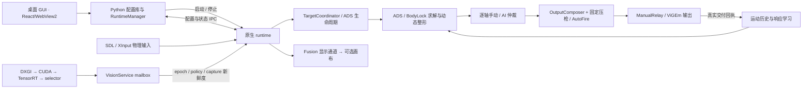

# 运行过程与状态归属

用户在桌面助手中维护配置；原生 runtime 在每个控制 tick 合并物理输入与有效视觉观测，产生受手动输入约束的辅助输出。GUI 不参与高频控制计算，Fusion 也不拥有控制权。

## 从启动到退出

GUI 把独立配置投影成 TOML，原生加载器验证模型、参数和配置身份。RuntimeManager 启动原生进程并记录 PID、创建时间和可执行路径；这些信息共同确认运行实例的归属。配置检查和模型查看可以在实际输出设备初始化前返回。

Vision worker 独占捕获与推理，控制线程读取最新 mailbox。相同快照不会刷新观测时间；新帧无目标、没有新帧、旧策略结果和过期观测是不同事件。只有通过当前策略、输入 epoch、来源身份与 capture 年龄检查的观测，才进入控制器。

身体框准入使用连续的高宽比范围，不会在 0.65–0.85 之间形成拒绝区。源胸部参考与区域高度也连续：高宽比不超过 0.30 时使用既有宽扁参考，不低于 1.00 时使用既有普通参考，中间以 smoothstep 空间权重混合两端。结果只依赖当前框和配置，不保存历史、不等待，也不由手动输入编辑。0.65 的类别标签仍供既有敌方证据/开火策略使用，不再切换瞄点或区域高度；框形状不证明头部可见性。类别、友军、置信度、尺寸和面积仍各自校验。GUI 几何预览协议 v4 使用原生导出的相同锚点与公式。

同一 selector generation 短暂缺帧时，TargetCoordinator 分别管理身份与预测：缺帧预测最多使用原 capture 后 32 ms 的证据，目标身份和未完成 ADS 则可保留到既有的 40 ms 硬时限。32–40 ms 内仅保留身份，不授予辅助瞄准或开火权；新鲜同目标观测回来后继续原任务。重复缺帧不刷新 capture 时间，友军/可靠性拒绝、身份切换、退出与手动换目标仍立即撤销延续。

控制器每 tick 完整执行输入解释、目标与 ADS 状态、求解、动态整形和逐轴手动仲裁。物理输入保持原有零死区透传，15%～30% 意图区间平滑变化；人工输入不修改源头选定的身体瞄点。固定压枪是独立贡献，最终由 OutputComposer 合成。

Relay 持有尚待交付的 AI 输出和截止时间；重复读取缓存不会延长它的有效期。手动保护、输出失败或设备重连中断连续性后，旧运动区间不能继续进入学习。停止按钮发送正常退出事件，runtime 撤销控制权、清理输出设备并停止线程。窗口关闭与 runtime 停止是两个不同操作。

## 谁持有哪些状态

| 状态 | 所有者 | 延续和失效规则 |
| --- | --- | --- |
| GUI 草稿、保存版本 | WorkspaceService / ProfileRepository | 保存经原生校验；保存不等于运行时已应用 |
| 输入作用域、逐轴意图 | 输入 reducers / IntentFilter | 保持轴间独立解释；显式退出继续生效 |
| selector generation | Vision selector | 标识来源身份；单帧 observation id 不是目标身份 |
| 目标与最近 capture 时间 | TargetCoordinator | Wait 可保留身份，Release 清除；cue 延续和缺帧不伪造直接观测或开火权 |
| 开镜任务、取得令牌、完成原因 | AdsLifecycleReducer | 单独维护 ADS 生命周期；目标切换不随意制造新令牌 |
| 待交付输出、回执和连续性 | ManualRelay / 输出设备 | 过期撤销；只以实际交付值和时间建立运动历史 |
| 运动历史与响应校准 | NativeGamepadController / estimators | 中断清历史，不自动抹去校准；配置保留规则另行决定 |
| 显示快照 | Fusion publisher / canvas | 只显示，不控制；捕获排除证明失效时隐藏 |

## 热更新

Bridge 在后台读取不可变候选并校验。涉及 Vision 策略时，控制 tick 请求新 revision，等对应 Fresh 快照后提交；等待期间继续遵守旧观测的时效，缓存输出不会续期。候选就绪时才归一化一次，再提交控制器配置和学习保留决定。GUI 以 `applied` 回执确认生效，`pending` 仅表示等待。

启动、有效配置导出和热更新遵循同一 live 策略：捕获推理只在 worker 执行，观测和开火来源寿命最多 40 ms。覆盖旧配置时导出标明 `live-policy` 来源。可编辑数值的范围、热更新资格和学习保留规则由 `native/controller_native/editable_parameters.json` 生成。

压枪仅使用开关、固定输出量和腰射倍率；旧 `feedback_amount` 是兼容别名。配置类型和解析边界仍接受部分历史字段，但它们不会启动武器识别、轨迹回放或第二套压枪算法。
